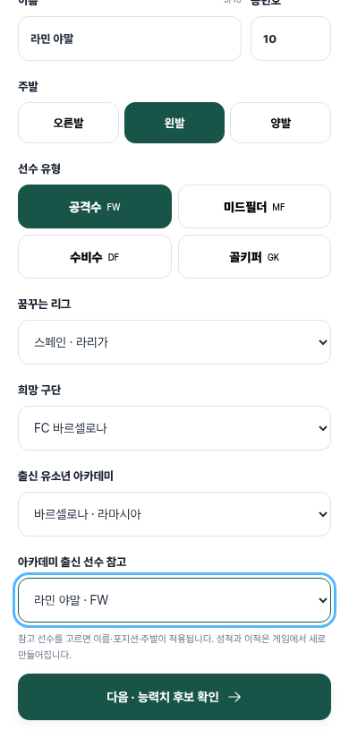

# 이번 생은 축구다!

유럽 유소년 아카데미에서 첫 프로 계약, 성장, 이적, 은퇴까지 플레이하는 축구 커리어 시뮬레이션입니다. [이번 생은 야구다](https://slbcareer.com/)를 브라우저로 직접 플레이하며 확인한 화면 구성과 진행 흐름을 축구에 맞춰 구현했습니다.



## 실행

Node.js 24 이상이 필요합니다. 현재 클라우드 환경은 Node.js 24를 사용합니다.

```sh
cd /workspace/myblog
npm ci
npm run dev -- --host 0.0.0.0 --port 4173 --strictPort
```

```sh
npm test
npm run build
# 개발 서버가 실행 중이고 Python Playwright와 Chromium이 설치된 환경에서:
python tests/browser-smoke.py
# 두 계정의 온라인 흐름을 임시 DB/빌드된 HTTP 서버로 검증:
node tests/browser-server.mjs
# 네 포지션과 두 온라인 선수를 자연 은퇴까지 진행:
node tests/browser-server.mjs tests/browser-career-full.py
# 모든 능력치의 특훈 게임과 터치 사인·PNG 저장:
node tests/browser-server.mjs tests/browser-training.py
node tests/browser-server.mjs tests/browser-urgent.py
# 악성 저장 파일·공개 프로필·브라우저 보안 정책:
node tests/browser-server.mjs tests/browser-security.py
# Instagram UA, 저장 차단, 터치 입력, PNG와 쿠키 거부 조건:
node tests/browser-server.mjs tests/browser-instagram.py
# 설치된 Playwright WebKit에서도 같은 조건 검증:
FOOTBALL_WEBKIT=1 node tests/browser-server.mjs tests/browser-instagram.py
```

클라우드 설치 스크립트는 [docs/setup.sh](docs/setup.sh), 시작 지침은 [docs/cloud-start.md](docs/cloud-start.md)에 있습니다. Vite와 animejs를 사용하며, 글꼴·아이콘·일러스트는 로컬 파일로 제공됩니다.

## 플레이

1. 이름, 등번호, 주발, 포지션, 희망 리그·구단, 유소년 아카데미를 선택합니다. 유명 아카데미 출신 선수의 이름을 참고하거나 직접 입력할 수 있습니다.
2. 같은 능력치 총합을 가진 후보 3명 중 하나를 고르고, 최대 2개 능력치에 성장 비중을 배분합니다.
3. U18 시즌의 스카우팅 리포트를 확인하고, 프로 입단 테스트에 참가하거나 U21 육성 과정에서 2시즌 더 성장합니다. 이후 U23 리저브 과정도 선택할 수 있습니다.
4. 계약서에 손가락·마우스로 사인하거나 이름 사인을 사용합니다. 특별훈련은 시즌당 1회, 커리어 전체에서 3회이며, 같은 능력치를 반복해서 훈련할 수 없습니다.
5. 계약 만료 시 재계약·이적을 선택합니다. 은퇴 후 커리어 카드를 PNG 이미지로 저장·공유하고 새 선수로 시작할 수 있습니다. JSON 데이터 백업은 별도 버튼에서 제공합니다.

공격수·미드필더·수비수는 슈팅, 패스, 드리블, 수비, 피지컬로 평가됩니다. 골키퍼는 반사신경, 위치선정, 캐칭, 킥, 피지컬과 선방·클린시트 기록을 사용합니다. 시즌별 성장, 컨디션, 부상, 감독 신뢰, 인기와 나이에 따른 기량 하락이 반영됩니다.

특별훈련은 기존 모달·5회 시도·점수·성장 보상을 유지하며 아래 게임으로 나뉩니다. 진행 중 새로고침해도 완료한 시도와 도전 과제를 복구합니다. 업데이트 전에 시작한 타이밍 훈련은 끝까지 이어갈 수 있습니다.

| 필드 플레이어 | 게임 | 골키퍼 | 게임 |
| --- | --- | --- | --- |
| 슈팅 | 골문 표적 누르기 | 반사신경 | 공이 나온 뒤 반응 세이브 |
| 패스 | 열린 동료 찾기 | 위치선정 | 슈팅 각도에 맞는 위치 선택 |
| 드리블 | 좌우 순서대로 콘 통과 | 캐칭 | 하이볼이 장갑 높이에 올 때 잡기 |
| 수비 | 공격수의 진입에 맞춰 태클 | 킥 | 버튼을 누르고 적정 파워에 놓기 |
| 피지컬 | 2초 동안 스프린트 | 피지컬 | 2초 동안 스프린트 |

수상 41종과 업적 94개를 제공합니다. 발롱도르, FIFA 올해의 선수, 유러피언 골든슈, FIFPRO 월드 XI, 코파 트로피, 골든보이, 야신 트로피, FIFA 최우수 골키퍼와 리그별 주요상이 포함됩니다. 나이·포지션·1군 성적·출전·평점·리그 성적에 따른 게임 수상이며 실제 투표나 현실의 수상 결과를 가져오지 않습니다. 선수 프로필의 ‘수상·업적 보기’에서 달성·미달성 항목을 확인합니다.

## 리그와 아카데미

7개 리그, 132개 구단, 34개 아카데미, 28명의 참고 선수를 제공합니다. 구단 구성은 **2025/26 기준의 고정 참고 목록**입니다. 승격·강등이나 최신 이적 시장을 자동으로 갱신하지 않습니다. 선수의 아카데미 경력은 참고 배경이며, 생성된 선수의 나이·성적·계약은 새 시뮬레이션입니다.

| 리그 | 구단 수 | 시즌 경기 | 아카데미 예시 |
| --- | ---: | ---: | --- |
| 프리미어리그 | 20 | 38 | 헤일 엔드, 캐링턴, 시티 풋볼 아카데미, 코밤 |
| 라리가 | 20 | 38 | 라마시아, 라 파브리카, 레사마, 수비에타 |
| 분데스리가 | 18 | 34 | FC 바이에른 캠퍼스, 브라켈 |
| 세리에 A | 20 | 38 | 진고니아, 비노보, 비스마라 |
| 리그 1 | 18 | 34 | PSG 캠퍼스, 메지외 |
| 에레디비시 | 18 | 34 | 더 투콤스트, 더 헤르트강, 바르케노르트 |
| 프리메이라리가 | 18 | 34 | 세이샬, 알코셰트, 올리발 |

리그 내 모든 상대와 두 번씩 경기합니다. U21/U23은 성장 시점을 표현하는 게임 경로로 통일했으며, 각 국가의 실제 리저브 리그 규정 전체를 재현하지 않습니다. 세부 데이터와 참고 링크는 [docs/football-data.md](docs/football-data.md)에 있습니다.

## 저장과 온라인 기능

비회원은 브라우저에 자동 저장하고, 로그인하면 SQLite 서버에 계정별 진행을 저장합니다. 이메일 가입·로그인·로그아웃과 저장 복구를 지원하며, 설정에서 전체 저장 파일을 내보내거나 가져올 수 있습니다. 수정하거나 가져온 기록은 온라인 랭킹에서 제외합니다.

인스타그램 내장 브라우저에서는 커리어 카드의 PNG 이미지를 길게 눌러 저장합니다. 사진 저장 메뉴나 로그인 쿠키가 제한된 경우에는 화면의 안내에 따라 Safari 또는 Chrome에서 열어 주세요. Google 로그인은 외부 브라우저를 사용하고, 내장 브라우저에서는 이메일 로그인을 제공합니다. 기기 저장이 차단되면 임시 플레이를 안내하며 계정의 서버 저장은 계속 사용합니다. 같은 계정으로 재접속하면 서버 기록을 복원합니다. WebGL을 사용할 수 없어도 모든 특훈과 카드 생성이 동작합니다. [호환성 검증 범위와 결과](docs/audit/instagram/review.md)에 브라우저 엔진 검증과 실기기 검증의 차이를 기록했습니다.

친구 닉네임 검색·초대·수락 또는 같은 포지션의 랜덤 매칭으로 커리어 매치를 시작합니다. 두 선수가 같은 후보에서 새 커리어를 진행한 뒤 양쪽 은퇴 시 LEGACY SCORE로 결과를 집계합니다. MY CLUB에는 은퇴 선수를 직접 보관하고, 온라인 보관 선수로 11인 팀을 만들어 도장깨기·ELO 랭킹전을 플레이합니다. 슬롯·회귀권·개명권은 서버 FC 잔액으로 구매하며 사용 내역을 저장합니다.

서버 데이터는 `.local/server.sqlite`에 보관합니다. 배포에서는 `FOOTBALL_DB`를 지속 가능한 저장소 경로로 지정하세요. `npm run build` 후 `PORT=4173 npm start`로 빌드된 화면과 API를 함께 제공합니다. HTTPS 역프록시를 사용하는 운영 환경에서는 `NODE_ENV=production COOKIE_SECURE=true PORT=4173 npm start`로 Secure 쿠키와 HSTS를 활성화합니다. 개발 API는 기본적으로 127.0.0.1에서만 열리며 Vite의 `/api` 프록시를 통해 접근합니다. `npm run preview`는 정적 화면 미리보기이므로 온라인 기능 검증에는 개발 서버 또는 `npm start`를 사용합니다.

Google OAuth는 환경 변수 연결 후 사용할 수 있으며 현재 실제 로그인은 미검증입니다. 상점은 게임 보상 코인을 사용하고 실제 현금 결제는 연결되지 않았습니다. [서버 기능·원본 대응·남은 차이](docs/online-server.md)에 상세 내용을 기록했습니다.

## 검증과 자료

- 엔진 테스트 26개 + 서버 테스트 26개 + 브라우저 호환성 로직 6개: 리그 경기·통계·성장·계약·이적·은퇴·주요상 자격·통산 기록·9종 특훈 입력·기존 저장 호환·계정 분리·대전·업적·팀 ELO·거래 제한·보안 회귀·저장 차단·로그인 쿠키 거부.
- 실제 Chromium 브라우저 검증 14개: 전체 플레이 경로, 리그·아카데미·참고 선수 선택, 파일 가져오기·내보내기, 새로고침 복구, 메뉴와 상점, 모바일 크기 320/390/430 및 데스크톱.
- 온라인 브라우저 검증 11개: 독립된 두 계정으로 가입, 친구 매치, 은퇴 결과, 보관, 업적, 팀 배틀, 구매, 개명, 재로그인 복구.
- 자연 은퇴까지 여섯 커리어: 네 포지션과 온라인 두 선수의 육성·계약·훈련·이적·저장 복구·최종 기록·대전 점수와 승패. [끝까지 플레이한 검수](docs/playthrough/review.md)에 원본 관찰과 결과를 기록했습니다.
- 10개 능력치 매핑의 특훈 9종을 각 5회 플레이하고, 비회원 마우스·온라인 터치 사인과 PNG 실제 다운로드를 검증했습니다. [긴급 카드 저장 수정](docs/audit/urgent/review.md)에 원인과 증거가 있습니다.
- [보안 검토](docs/audit/security/review.md): HTML 주입, 온라인 장비·코인 변조, 난수 예측·공개 범위, 비정상 URL, 의존성을 수정하고 보안 브라우저 3개 시나리오·개발 서버 접근 차단을 검증했습니다. `npm audit`의 알려진 취약점은 0개입니다.
- [원본 플레이 분석](docs/source-analysis.md), [화면 검수](design-qa.md), [원본과 축구 버전 비교](docs/qa/home-mobile.png).

원본 사이트의 서버 계산식과 계정 데이터는 사용하지 않습니다. 능력치 성장과 경기 결과는 독립적으로 구현한 축구 엔진이 계산합니다. 이 작업 공간에는 처음에 애플리케이션 파일이나 Git 커밋이 없었으며, 현재 결과는 작업 공간에 생성된 상태입니다.

## 에셋

축구 경기장과 로고는 원본 화면을 시각적 참고로 사용하여 Image Gen으로 제작했습니다. Do Hyeon과 Pretendard는 SIL OFL, Phosphor 아이콘은 MIT 라이선스이며, 해당 라이선스 파일은 `public/fonts`와 `public/icons`에 포함됩니다. 132개 구단 로고는 [football-logos](https://github.com/luukhopman/football-logos)의 2025/26 참고 PNG를 로컬에 저장했습니다. 구단 로고의 권리는 각 구단에 있으며 원본 경로는 `public/clubs/sources.json`에 기록했습니다.

최근 오류 수정과 회귀 검증은 [수정 보고서](docs/audit/fixes.md)에 기록했습니다. 전체 1:1 대응 여부는 [최종 대조 검수](design-qa.md)의 판정을 따릅니다.
