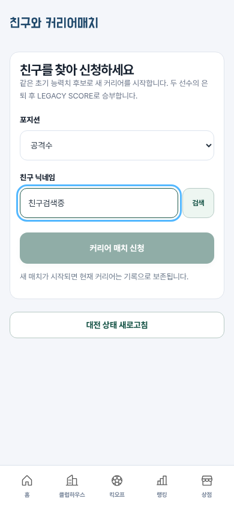
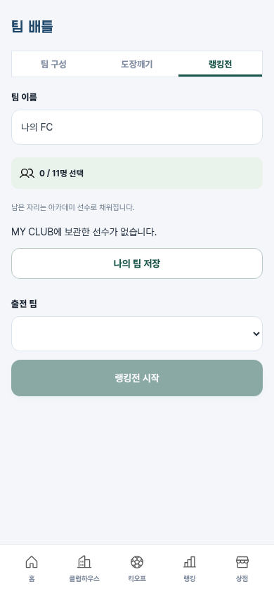

# 오류 수정 및 로직 검증 — 2026-10-10

기존 검수의 오류 3건을 수정했다. 관련 저장·경기 로직을 확인하면서 발견한 추가 오류도 함께 수정했다.

## 수정 사항

- 대전 참가 기록의 저장 파일 덮어쓰기 차단: 진행 중인 대전 선수의 변경·삭제·현재 선수 교체를 거부한다. 완료된 대전 기록도 임의 변경할 수 없다. 거부 시 저장 버전과 선수 기록을 유지한다. 테마·음소거 등 기록을 변경하지 않는 저장과 정상 서버 진행은 허용한다.
- 승패 계산 시 양쪽 기록의 서버 검증 상태를 확인한다. 이전 버전에서 유입된 미검증 기록도 새 승패 판정에 쓰지 않는다.
- 미검증 선수를 회귀권으로 검증 선수로 전환하는 경로를 차단했다. 거부 시 회귀권과 저장 기록은 그대로 유지한다.
- 친구 대전 폴링은 상태 목록만 갱신한다. 검색 입력 DOM·검색어·포커스·선택 범위를 보존한다. 수동 화면 갱신에도 검색어를 유지한다.
- 팀 배틀 탭 강조와 접근성 선택 상태를 현재 모드에 맞춘다. 모드를 전환해도 작성 중인 팀 이름과 출전 팀 선택을 유지한다.
- 같은 이름의 두 팀도 실제 득점·승부차기로 승패와 ELO를 계산한다. 팀 이름 비교로 인한 잘못된 승리 집계를 제거했다.
- 개명권 사용 응답에 갱신된 잔액·아이템 정보를 포함해 클라이언트가 남은 개명권을 즉시 반영하도록 했다.

## 검증

- `npm run build`: 통과.
- `npm test`: 엔진·서버 30개 통과.
- `python tests/browser-smoke.py`: 일반 브라우저 점검 14개 통과.
- `node tests/browser-server.mjs`: 온라인 브라우저 점검 11개 통과.
- 총 55개 검증 통과. 대전 기록 변조와 미검증 회귀, 동일 팀 이름 문제는 수정 전 재현 테스트 실패를 확인한 뒤 수정했다.
- API 테스트와 계정 생성 브라우저 테스트는 별도 테스트 DB에서 실행했다.

## 수정 후 화면

친구 닉네임 입력 후 4.3초가 지나도 검색어와 포커스가 유지된다.

랭킹전 선택 후 해당 탭이 강조된다.

## 범위

과거 검수 화면과 오류 설명은 `review.md`에 수정 전 증거로 보존했다. 이미 완료된 과거 대전 결과를 일괄 재계산하거나 기존 저장 데이터를 변경하지 않았다. Google OAuth 실제 인증·실결제 및 원본 로그인 이후 화면 비교는 이번 수정의 검증 범위 밖이다.
