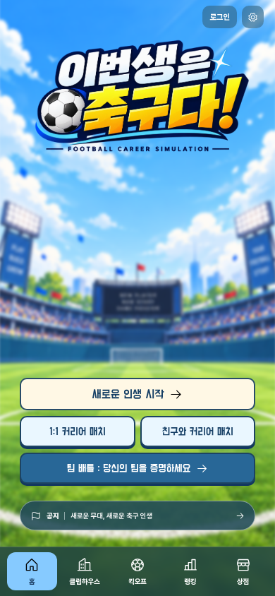
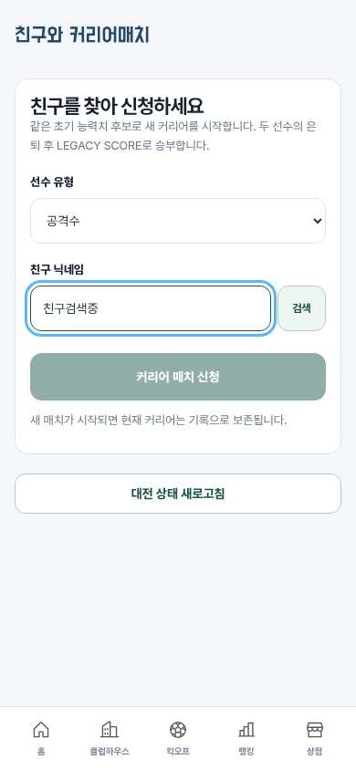
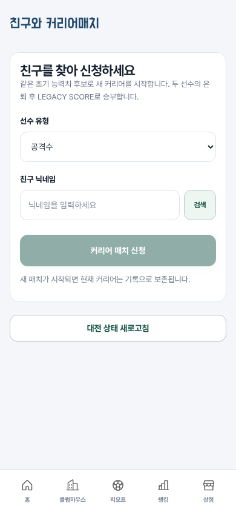
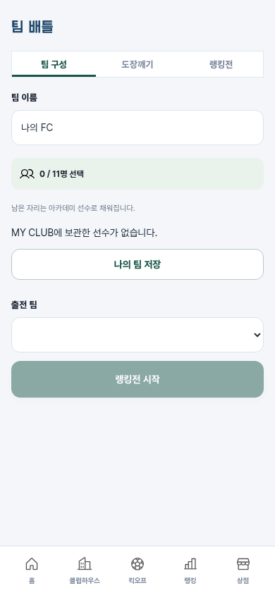

# 구현 검수 — 2026-10-10

> 아래는 수정 전 검수 기록입니다. 오류 수정과 재검증 결과는 [후속 수정 보고서](fixes.md)를 참고하세요.

판정: 수정 필요. 정상 경로 테스트와 별개로 대전 판정의 무결성 오류 1건, 화면 동작 오류 2건을 이번 검수에서 재현했다. 애플리케이션 코드는 수정하지 않았다.

## 우선순위별 발견 사항

### 1. [P1] 미검증 저장 파일로 친구 대전 결과를 조작할 수 있음

- 위치: `server/app.js:83–93` (`updateDuels`), 저장 파일 처리 `server/app.js:273` 이후.
- 격리된 메모리 DB에서 두 계정으로 친구 대전을 시작하고 정상 커리어 명령으로 프로에 진입했다. 상대를 은퇴시킨 뒤 본인 저장 파일의 은퇴 상태, 최고 능력치, 국가대표 출전 수를 변경해 `/api/save`로 제출했다.
- 서버는 `verified:false`를 반환했지만 대전은 `complete`가 되었으며 변경한 계정이 12,455 대 467로 승리했다. ‘미검증 저장으로 대전을 완료하면 안 된다’는 재현 테스트가 실패했다.
- 원인: 대전 판정은 `careers.data`만 읽고 `verified`를 확인하지 않는다. 공개 랭킹에서 제외하는 기존 방어가 대전에는 적용되지 않는다.
- 권고: 대전 참가 커리어의 임의 덮어쓰기를 차단하거나 경쟁용 서버 기록을 별도로 유지한다. 미검증 기록은 승패 계산에서 제외하고 매치 복구·무효 처리도 정의한다. 양쪽 검증 상태를 포함한 회귀 테스트가 필요하다.

### 2. [P2] 친구 닉네임 입력과 키보드 포커스가 4초마다 사라짐

- 위치: `src/online-ui.js:37–42`, `src/online-ui.js:85`, `src/main.js:244–251`.
- 로그인 → 친구와 커리어 매치 → `친구검색중` 입력 → 약 4.3초 대기. 입력 값이 빈 문자열이 되고 포커스도 입력창에서 사라졌다.
- 원인: 폴링 완료 시 전체 화면을 다시 만들지만 검색어 상태를 보관하지 않는다. 포커스 복구도 `data-action` 버튼에 한정된다.
- 영향: 천천히 입력하는 사용자와 한글 조합 입력, 키보드 이용자의 검색을 방해한다.
- 권고: 대전 상태 부분만 갱신하거나 입력 값·선택 범위·포커스를 유지한다. 검색어 입력 중 폴링 테스트를 추가한다.

### 3. [P2] 팀 배틀의 선택 탭과 실제 실행 모드가 다름

- 위치: `src/online-ui.js:91`.
- 팀 배틀에서 ‘랭킹전’을 눌렀을 때 실행 버튼은 ‘랭킹전 시작’으로 바뀌지만 강조된 탭은 계속 ‘팀 구성’이다.
- 원인: 팀 구성 버튼에 `active`가 고정돼 있고 다른 탭에는 현재 상태가 반영되지 않는다.
- 권고: 선택된 화면/모드를 상태로 관리해 탭 강조와 내용, 실행 버튼을 일치시킨다. 선택 상태를 `aria-selected` 또는 적절한 버튼 상태로도 전달한다.

## 확인한 흐름과 현재 화면

1. 홈 진입 — 양호. 390×844에서 주요 시작 버튼과 하단 내비게이션이 화면 안에 보인다.
2. 이메일 회원가입 — 양호. 별도 테스트 계정 가입 후 로그인된 홈으로 이동했다. 가입 폼 자체의 시각·접근성 전체 검수는 이번 캡처 범위 밖이다.
3. 친구 검색 입력과 대기 — 오류. 전후 화면에서 입력·포커스 소실을 확인했다.
4. 팀 배틀의 랭킹전 선택 — 오류. 탭과 실행 버튼의 상태가 불일치한다.
5. 친구 대전 결과 검증 — 오류. 별도 API 재현 테스트에서 미검증 데이터가 승패에 반영됐다. 이 판단은 화면 추정이 아닌 실제 응답에 근거한다.

### 1. 홈

### 3. 친구 검색 입력 직후

### 3. 4.3초 후

### 4. 랭킹전 선택 후

## 검증 범위와 한계

- 이번 실행에서 프로덕션 빌드, 엔진·서버 테스트 26개, 일반 브라우저 점검 14개, 온라인 브라우저 점검 9개가 통과했다(총 49개). 추가한 대전 무결성 재현 테스트는 예상 보호 조건을 만족하지 못해 실패했다.
- 브라우저 화면은 이번 실행에서 새로 캡처하고 파일을 직접 열어 확인했다. 서버 오류 재현은 격리된 메모리 DB만 사용했다.
- 친구 입력창의 포커스 소실은 직접 재현된 접근성 문제다. 스크린리더, 전체 명도 대비, 모든 키보드 동선은 검증하지 않았으며 접근성 준수를 보증하지 않는다.
- 원본 서비스의 로그인 이후 화면, Google OAuth 실제 인증, 실결제는 이번에 확인하지 않았다. 따라서 원본과 1:1 구현 완료 또는 배포 준비 완료로 판정하지 않는다.
