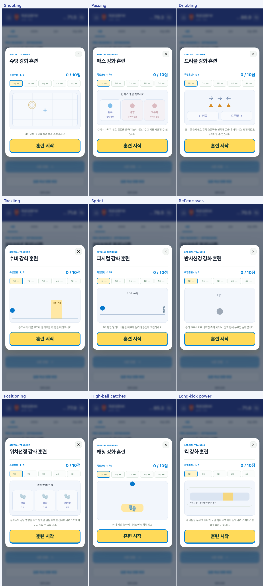

# 원본과 축구 버전 완주 검수

2026-10-11. 원본 `https://slbcareer.com/`을 실제 Chromium에서 프로 입단부터 은퇴 이후 최종 카드까지 플레이했습니다. 구현도 화면 조작으로 네 포지션과 온라인 두 선수의 여섯 커리어를 자연 은퇴까지 진행했습니다. 원본 플레이와 구현 검증을 위해 API 응답을 가짜로 바꾸거나 저장 데이터를 편집하지 않았습니다.

## 실제 원본 플레이

선수는 최현우·선발투수·15번·마산용마고 출신이며 광주 재규어스에 입단했습니다. U18 결과의 스카우팅 리포트, 대학/해외 제안 화면을 확인한 뒤 실제 진행은 드래프트 직행을 선택했습니다.

| 시점 | 직접 플레이한 흐름 |
| --- | --- |
| 2026 | 고교 시즌 결과와 스카우팅 리포트 |
| 2027 | 1라운드 9순위 지명, 연봉 3,300만원·계약금 3억원, 신인 계약 사인 |
| 2028 | 시즌 도중 1군 콜업 확인, 스토브리그 육성 선택 |
| 2030 | 아시안게임 금메달·병역 면제 |
| 2034 | WBC 우승, 통산 기록 돌파 안내 |
| 2036 | FA 6년·총 보장액 218.4억원, 계약 확인 |
| 이후 | 부상과 회복 선택, 보직 제안, 주장 수락, 반복 FA·노화 |
| 2047 종료 | 구단의 은퇴 권고 수락 → 영구결번 → 21시즌 회고 → 최종 카드·커리어 기록 |

원본은 표시 나이 40세, 프로 21시즌, LEGACY 5,666으로 끝났습니다. 최종 기록은 240승·2,995.2이닝·3,771탈삼진·평균자책 2.32·WAR 104.7이며, MVP 8회와 소속 팀 한국시리즈 우승 5회가 표시됐습니다. ‘현역 은퇴’ 버튼으로 강제 종료하지 않았습니다.

- [실제 조작 기록과 최종 텍스트](source/results.json): 114개 조작 기록. 초기 고교 단계는 아래 캡처로 함께 확인합니다.
- [U18 스카우팅](source/02-youth-result.png), [신인 계약](source/03-contract.png), [국가대표 선택](source/04-national-selection.png), [통산 기록](source/05-milestone.png).
- [은퇴 권고](source/09-retirement-recommendation.png), [영구결번](source/10-retired-number.png), [최종 카드](source/11-final-card.png), [은퇴 후 커리어](source/12-retired-career.png).

## 끝까지 진행하며 고친 문제

1. 카드 저장이 JSON 데이터를 내려보내 내장 브라우저에서 데이터와 깨진 한글을 표시했습니다. PNG 미리보기·다운로드·파일 공유로 변경하고 JSON 백업은 별도 버튼으로 분리했습니다. [저장/사인 증거](../audit/urgent/review.md).
2. 계약 사인 영역이 입력을 받지 않았습니다. 마우스·손가락·펜으로 그리는 서명과 이름 사인·지우기를 구현하고, 유효한 서명이 있어야 신인/FA 계약을 확정하도록 했습니다.
3. 득점·도움 생성 함수가 최대 14개에 막혀 22골 득점왕과 17도움 도움왕을 받을 수 없었습니다. 잘못된 반복 상한을 수정했습니다. 이번 여섯 완주에서는 시즌 최대 30골·23도움과 실제 타이틀 수상을 확인했습니다.
4. 원본 플레이에서 확인한 U18 스카우팅과 통산 기록 돌파 안내, 은퇴 사유 표시를 축구 기록에 맞춰 추가했습니다. [스카우팅 화면 대조](scouting-comparison.png).
5. 주요 축구상 등 41종 수상과 94개 업적을 제공합니다. 발롱도르·FIFA 올해의 선수·유러피언 골든슈·FIFPRO 월드 XI·코파 트로피·골든보이·야신 트로피·FIFA 최우수 골키퍼와 리그별 주요상이 포함됩니다. 1군 출전·포지션·나이·평점·팀 성적 등으로 자격을 판단하는 게임 규칙이며 현실의 투표·모든 공식 규정을 복제하지 않습니다.
6. 일반 득점왕과 리그 골든부트가 같은 수상을 두 번 계산했습니다. 별칭을 유지하면서 코인·인기도 보상과 LEGACY는 한 번만 계산합니다. 유러피언 골든슈처럼 별개의 상은 따로 계산합니다.
7. 특훈 3종 완료 업적이 세 번째 훈련을 시작하자마자 열렸습니다. 5회 시도를 마쳐 결과를 확정한 뒤 달성하도록 고쳤습니다. 만점 업적은 이후 다른 훈련 점수가 낮아도 유지합니다.

## 능력치별 특별훈련

기존 파란 모달, 5회 시도, 0/1/2점과 능력 상승 보상은 유지했습니다. 같은 게임을 모든 능력치에 사용하던 구성을 아래처럼 바꿨습니다. 피지컬 게임은 양쪽 포지션이 공유해 총 9종입니다.

| 필드 플레이어 | 조작 | 골키퍼 | 조작 |
| --- | --- | --- | --- |
| 슈팅 | 골문 표적 누르기 | 반사신경 | 초록색 신호 후 세이브 |
| 패스 | 열린 동료 선택 | 위치선정 | 슈팅 방향에 맞는 위치 선택 |
| 드리블 | 좌우 순서대로 콘 통과 | 캐칭 | 하이볼이 장갑 높이에 올 때 잡기 |
| 수비 | 진입하는 공격수에 맞춰 태클 | 킥 | 누르고 파워 구역에서 놓기 |
| 피지컬 | 2초 동안 빠르게 달리기 버튼 누르기 | 피지컬 | 같은 스프린트 게임 |

터치/마우스와 키보드 조작을 지원합니다. 서버는 점수를 직접 받지 않고 게임 종류에 맞는 입력을 검사해 점수를 계산합니다. 타이밍·반응시간은 클라이언트가 측정하므로 외부 자동 조작까지 방지하는 장치는 아닙니다. 새로고침하면 완료한 시도와 도전 과제를 복구하고, 업데이트 전에 시작한 기존 타이밍 훈련도 이어서 완료할 수 있습니다.

## 구현의 실제 완주 결과

각 커리어는 U18 1시즌, U21 2시즌, U23 2시즌을 거친 뒤 입단 테스트·계약·서로 다른 특훈 3회·이적·시즌 결과·통산 기록 안내를 진행했습니다. 5프로 시즌 시점에 새로고침으로 저장 복구를 확인했습니다. 자연 은퇴 후 전체 시즌 수·통산 기록·카드 점수·PNG 파일·JSON 백업·재로딩 결과를 검증했습니다.

| 커리어 | 최종 표시 나이 | 프로 시즌 | 최고 OVR | LEGACY | 이적 |
| --- | ---: | ---: | ---: | ---: | ---: |
| 공격수 | 40 | 17 | 100.0 | 10,691 | 5 |
| 미드필더 | 40 | 17 | 100.0 | 6,805 | 5 |
| 수비수 | 40 | 17 | 100.0 | 2,547 | 5 |
| 골키퍼 | 43 | 20 | 99.9 | 8,621 | 6 |
| 온라인 공격수 1 | 40 | 17 | 99.9 | 8,916 | 5 |
| 온라인 공격수 2 | 40 | 17 | 100.0 | 7,380 | 5 |

온라인 두 선수는 동일 후보로 시작해 각자 성장 방향을 선택했습니다. 양쪽 자연 은퇴 후 서버가 8,916 : 7,380을 집계하고 각 계정에 승리/패배를 표시했습니다. [최종 대전 화면](implementation/online-natural-duel-complete.png). 전체 수치와 시즌별 수상은 [실행 결과](implementation/results.json)에 있습니다. 콘솔 오류·미처리 예외는 0개입니다.

## 검증 명령과 결과

| 검증 | 명령 | 결과 |
| --- | --- | --- |
| 엔진·서버 | `npm test` | 26 + 14 = 40개 통과 |
| 빌드 | `npm run build` | 성공 |
| 비회원·반응형 | `node tests/browser-server.mjs tests/browser-smoke.py` | 14개 통과 |
| 두 계정 온라인 | `node tests/browser-server.mjs` | 11개 통과 |
| 자연 은퇴 완주 | `node tests/browser-server.mjs tests/browser-career-full.py` | 6커리어·최종 대전 통과 |
| 능력치별 특훈 | `node tests/browser-server.mjs tests/browser-training.py` | 10개 매핑 × 5시도, 9종 게임 통과 |
| 직접 사인·PNG 저장 | `node tests/browser-server.mjs tests/browser-urgent.py` | 비회원 마우스·온라인 터치 두 환경 통과 |

브라우저 테스트는 Chromium의 실제 화면과 파일 다운로드를 사용합니다. 온라인 테스트는 임시 메모리 SQLite와 빌드된 HTTP 서버에서 수행하므로 운영/개발 저장 데이터를 변경하지 않습니다. 업적 화면의 달성/미달성 목록, 킥 키보드 길게 누르기와 반복 입력, 진행 중 훈련 복구도 확인했습니다. [특훈별 점수 결과](training/results.json).

## 남은 원본 대응 차이와 검증 한계

원본 한 커리어를 끝까지 플레이한 결과이며, 대학/해외 이적 제안은 관찰만 했습니다. 모든 숨겨진 분기·성장/성적/수상/LEGACY 계산식의 1:1 동일성을 증명한 결과는 아닙니다. 원본의 금색 최종 카드·영구결번·자동 연대기와 구현의 기존 파란 PRIME 카드에도 차이가 있습니다. 축구 규칙과 능력치별 특훈은 사용자의 요청에 맞춘 변경입니다.

원본의 인증 후 화면·Google 실제 로그인·현금 결제는 검증 범위에 포함하지 않았습니다. 인스타그램 앱/iOS 실기기도 실행하지 못했으며, Chromium에서 터치 이벤트·PNG 다운로드·페이지가 JSON으로 바뀌지 않는 동작을 확인했습니다. 전체 1:1 판정과 남은 항목은 [화면 대조 검수](../../design-qa.md), [서버/원본 대응](../online-server.md)에 있습니다.
